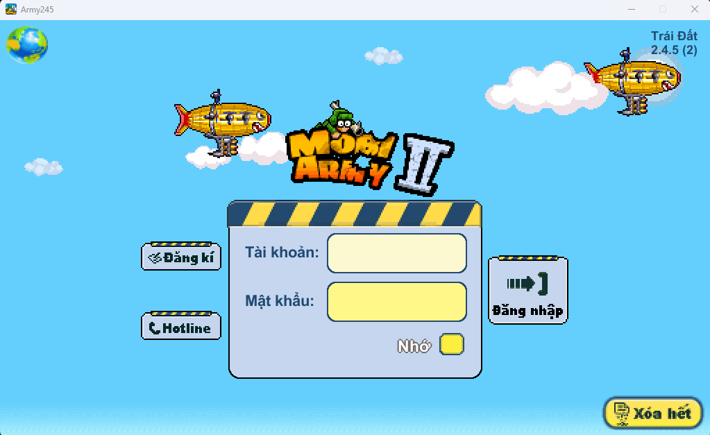
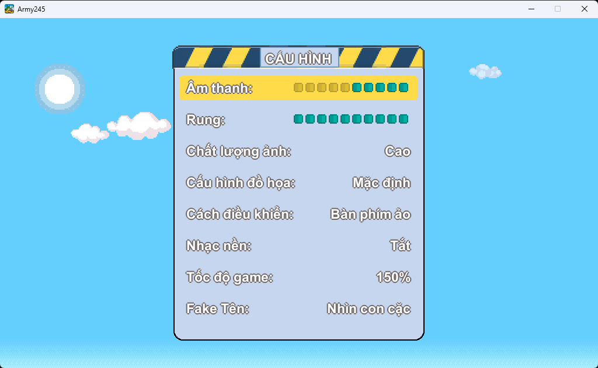
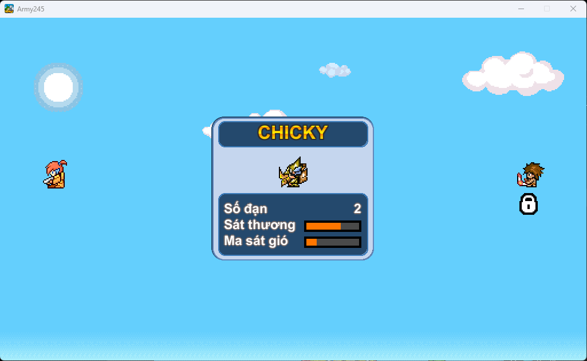
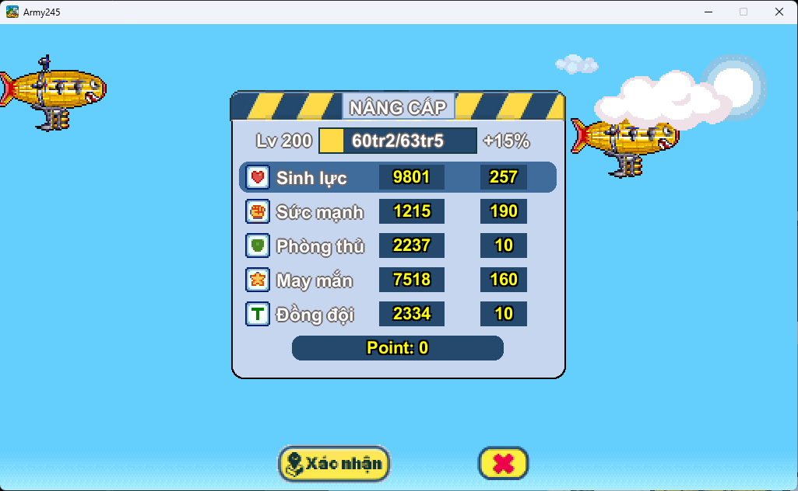
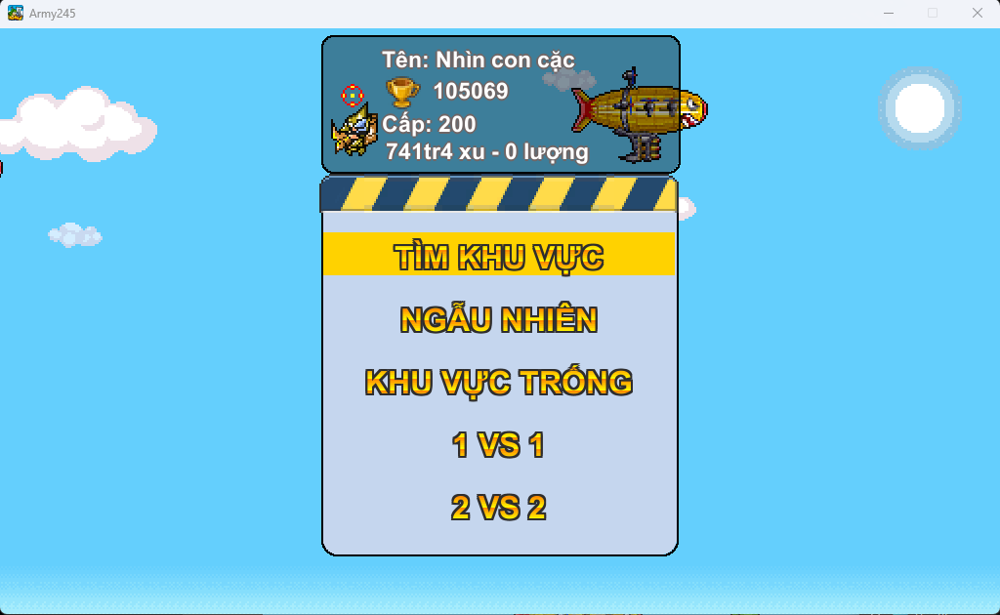
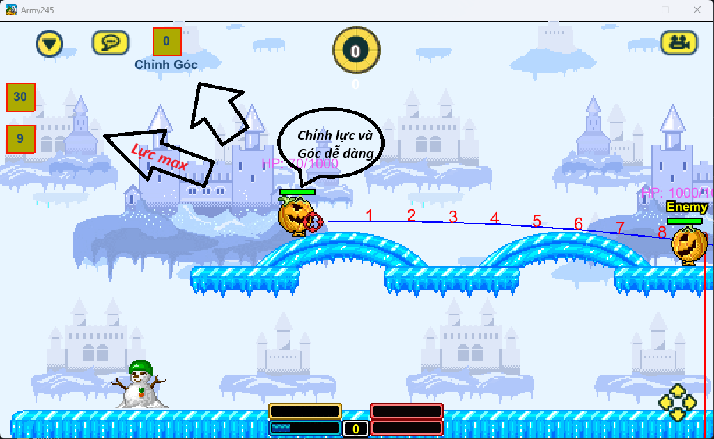
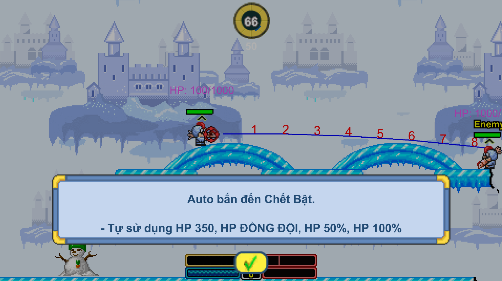

# 🎮 Mobi Army 245

**Mobi Army 245** là dự án game được phát triển và tùy chỉnh trên nền tảng **Unity**, hướng đến khả năng build và trải nghiệm trên nhiều nền tảng khác nhau.

## ✨ Tính năng

- 🎯 Kẻ góc.
- 💎 Auto đập ngọc.
- ⚡ Cộng chỉ số nhanh.
- 🚀 Tùy chỉnh tốc độ 100->2000%.
- 👤 Fake tên nhân vật – Tùy chỉnh tên hiển thị.
- 🚀 Cải thiện tốc độ game – Tối ưu hiệu năng trò chơi.
- 🔧 Auto Tự Pem – Tự động bắn khi đến lượt (kèm Pow khi có).
- 🔧 Chỉnh Góc – Chỉnh góc Pem nhằm fix lỗi tốc độ game quá nhanh
- 🎋 Auto đổi bánh chưng, bánh tét – Tự động đổi vật phẩm.

## 🔥 PB Update
- 🔧 **Auto Tự Pem** – Thêm sử dụng item HP 350, 50%, 100%, Đồng Đội.
- 🔧 **Quản lý Tài Khoản** – Thêm được nhiều tài khoản đổi 1 chạm không cần gõ lại.

## 🔒 Cam kết bảo mật

- 🛡️ **Không Keylog** – Không ghi lại phím bấm để thu thập thông tin trái phép.
- 🔐 **Không đánh cắp tài khoản** – Không thu thập trái phép mật khẩu hoặc thông tin đăng nhập.
- 🚫 **Không mã độc** – Không chủ động tích hợp mã độc gây hại cho thiết bị.
- 🔍 **Minh bạch** – Công khai các tính năng và hành vi thu thập dữ liệu (nếu có).

## 📦 Nền tảng hỗ trợ

| Nền tảng | Định dạng | README |
|---|---|---|
| Android | APK | [README-APK.md](README-APK.md) |
| iOS | IPA | [README-IOS.md](README-IOS.md) |
| Windows PC | EXE | [README-PC.md](README-PC.md) |

Các bản phát hành được xây dựng từ cùng một project Unity. Khả năng sử dụng thực tế phụ thuộc vào cấu hình build và mức độ tương thích của từng nền tảng.

## 🛠️ Công nghệ

- **Game Engine:** Unity
- **Ngôn ngữ:** C#
- **Nền tảng build:** Android, iOS và Windows

## 📥 Tải xuống

Các bản phát hành sẽ được cập nhật tại mục [Releases](../../releases) của repository khi có phiên bản được công bố.

## 📸 Hình ảnh trong game

   
  <b>🔐 Đăng nhập</b>

<table>
  <tr>
    <td align="center" width="33%">
       
      <b>⚙️ Cài đặt</b>
    </td>
    <td align="center" width="33%">
       
      <b>👤 Chọn nhân vật</b>
    </td>
    <td align="center" width="33%">
       
      <b>📊 Nâng cấp điểm</b>
    </td>
  </tr>
  <tr>
    <td align="center">
       
      <b>🔎 Vào nhanh</b>
    </td>
    <td align="center">
       
      <b>⚔️ Chỉnh lực và Góc bắn dễ dàng</b>
    </td>
    <td align="center">
       
      <b>⚔️ Tự động Pem đến hết trận</b>
    </td>
  </tr>
</table>

## 👨‍💻 Tác giả

**Bùi Duy Anh**

## ⚠️ Lưu ý

- Tính năng và khả năng tương thích có thể khác nhau tùy bản build.
- Việc phân phối ứng dụng cần tuân thủ các quyền sở hữu trí tuệ và điều khoản liên quan.
- Chỉ tải và sử dụng các bản phát hành từ nguồn đáng tin cậy.

## 📄 Giấy phép

Giấy phép sử dụng và phân phối dự án cần được xác định theo quyền sở hữu mã nguồn và tài nguyên được sử dụng.

---

  <strong>Mobi Army 245</strong> 
  <i>One project. Multiple platforms. Powered by Unity.</i>

